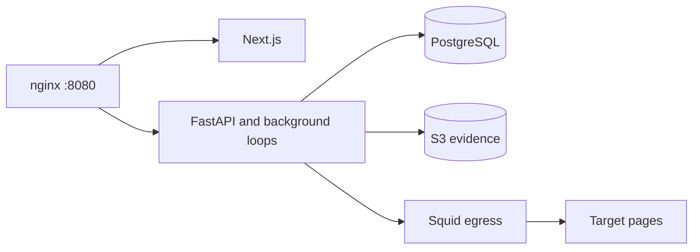

# WebMonitor-Agent

Active product of the workspace. Workspace-wide rules live in `../AGENTS.md`; this file covers only this repository. Deployment and image mechanics: `../docs/deployment.md` and `../docs/release.md`.

## Runtime

Python 3.12, FastAPI, async SQLAlchemy/PostgreSQL and a Next.js frontend. `webmonitor serve` starts HTTP and five loops in one event loop: scheduler, agent, HTTP collection, browser collection and mail. `WORKERS_ENABLED=false` disables loops. Do not introduce separate worker coordination.



All asynchronous work is a `jobs` row: agent, analyze, preview or production. `services/jobs.py` is the only enqueue/claim/renew/finish/requeue/cancel protocol. Claims use `FOR UPDATE SKIP LOCKED`, leases and partial unique indexes to prevent duplicate active work. Never construct jobs elsewhere or add a second claiming path.

Conversation messages queue agent work. Orchestration rebuilds bounded message history and exposes tools for target analysis, draft saving, preview and creation requests. Read-only SSE sends a bounded recent snapshot plus lightweight text deltas; older messages use cursor pagination and polling remains the reconnect fallback. Durable jobs are the recovery source. Every stream poll revalidates the browser session and request DB sessions close before streaming starts.

Preview results are frozen into the draft, including fields, coverage, evidence, rule simulation, rendered email, recipients and expiry. Creation occurs only through the approve endpoint and `services/drafts.py:publish_draft`, which locks and revalidates the revision, hash and recipients. A tool request alone never creates the monitor.

Production collection schedules a job, fetches the target, extracts and validates fields, uploads evidence, then commits snapshot/events/deliveries transactionally. Invariants:

- Network, browser, S3 and SMTP I/O stay outside database transactions.
- Evidence references are committed only after successful upload.
- First successful production collection establishes a baseline without an event or change email.
- Failed collection preserves the last trusted baseline.
- Browser sandbox unavailability returns `browser_unavailable`; never fall back to an unsandboxed browser.
- Readiness checks PostgreSQL and expected tables only. S3 bucket failures are retried by uploads and do not broaden readiness.

Important modules: `cli.py`, `worker.py`, `models.py`, `db.py`, `config.py`; `api/`, `agent/`, `collection/`, `services/`, `security/`, `notifications/` and `storage/` under `src/webmonitor/`.

## Conventions

- New Pydantic boundaries reject unknown fields; immutable contracts stay frozen. `DraftSpec` is shared by API, agent and workers, not duplicated.
- Errors use `DomainError(code, status, message, details)` and the standard API envelope. Never leak exception reprs, SQL parameters or credentials.
- Services explicitly commit at route/service boundaries, enforce ownership via `require_owner`, and keep all asynchronous work in the jobs protocol.
- Environment access goes through the project settings module, with `SecretStr` for credentials. Settings caches mean tests set environment before first access.
- Logs carry stable messages and bounded metadata such as method, route template, status or revision. Never log authorization, request bodies, tokens or passwords.
- Thin routes, services for domain logic, pure extraction/state/schema modules for computation, CLI for process startup.

## Frontend

Next.js App Router, React, strict TypeScript, Tailwind and TanStack Query. The workspace is conversation-first, with a chat panel and monitor/draft context. SSE is the live source, with polling fallback and cursor-based older history. Parse untrusted draft preview JSON with the existing zod schema in `web/src/lib/api/preview.ts`; its collection limits must match the backend `MonitorSpec`.

HTTP goes only through `web/src/lib/api/client.ts:api()`: relative paths, CSRF on mutations, same-origin credentials, no-store and structured `ApiError`. Preserve the 401 session-clear/login redirect. Do not add direct API fetches or hand-edit generated `schema.d.ts`. Component files use kebab-case and exports PascalCase.

## Commands

Create the repository-dedicated development environment once. Do not use the base Conda environment or ad-hoc `/tmp` virtual environments for checks:

```sh
conda create -n webmonitor-agent -c conda-forge python=3.12 nodejs=22 pip -y
conda run -n webmonitor-agent python -m pip install --require-hashes -r requirements.txt
conda run -n webmonitor-agent python -m pip install --no-deps --editable .
conda run -n webmonitor-agent python -m pip check
```

Run backend checks with `conda run -n webmonitor-agent ...` (for example, `conda run -n webmonitor-agent pytest tests/unit -q`). For frontend checks, enter the environment with `conda activate webmonitor-agent` so Node 22 is on `PATH`, then use Corepack pnpm in `web/`.

```sh
# Source development: replaces the published image with a local build
docker compose -f compose.yaml -f compose.build.yaml up --build -d --wait

# Tests
docker compose run --rm --entrypoint pytest api -q
```

`pytest` discovers `tests/unit` and `tests/integration`; browser acceptance is separate. The integration fixture creates and drops a disposable database, so it never points at a shared one. No coverage threshold is promised.

Generate `schema.d.ts` with the frontend’s `generate:api` script in a Node development environment with source mounted and network access to `http://api:8000/api/v1/openapi.json`; never hand-edit it.

## Deployment facts

The released deployment, download list and `.env` template are in `../docs/deployment.md`. The PostgreSQL and MinIO data directories are tmpfs: recreating either data container loses its data, and there are no migrations or bundled backups. Agent plain HTTP needs `DEVELOPMENT_MODE=true` and a >=32-character secret. Ordinary deployments keep `TARGET_POLICY=public`; pointing a collector at mocksite is the integrating deployment's network and policy job.
