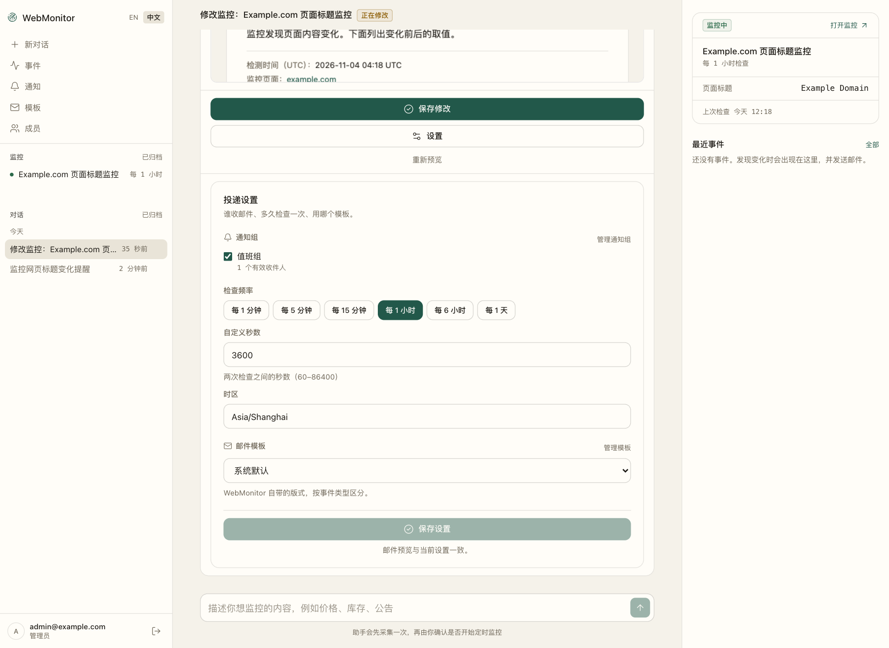

<h1 align="center">WebMonitor-Agent</h1>

<p align="center">
  <strong>A website monitor you set up by talking to it.</strong>
</p>

<p align="center">
  Describe the page and the condition in your own words. The assistant reads the page, extracts the values, and shows you a real sample before anything is scheduled.<br>
  After you confirm, it checks on time, stores the evidence, and emails you when your condition is met.
</p>

<p align="center">
  <a href="#what-it-is">Overview</a> ·
  <a href="#install-in-three-steps">Quick start</a> ·
  <a href="#create-your-first-monitor">First monitor</a> ·
  <a href="#email-alerts">Email alerts</a> ·
  <a href="#faq">FAQ</a> ·
  <a href="#update-roll-back-and-your-data">Updates and data</a> ·
  <a href="./README.zh-CN.md">简体中文</a>
</p>



## What it is

WebMonitor-Agent is a self-hosted change monitor for public web pages. You do not write selectors or cron expressions: you hold a conversation. The assistant inspects the target page, proposes what to extract, runs a real collection, and puts the result in front of you. Only your click on **Create monitor** starts the schedule.

Everything runs from one Docker Compose stack — a Next.js interface, a FastAPI service with its background loops, PostgreSQL, S3-compatible evidence storage and a Squid egress proxy. There are no external accounts or hosted services beyond the model endpoint and optional SMTP account you configure.

### What you can watch

Any public page. You say which values matter and what counts as a change; the product has no built-in notion of a page type, a product, a price or a notice board.

A rule can watch text, a keyword appearing or disappearing, a number against a threshold, a percentage or absolute change, or new, updated and removed items in a list.

It checks public `http://` and `https://` pages on ports 80 or 443, every 1 minute to 24 hours. Pages behind a sign-in, and content inside iframes or Shadow DOM, are outside what the collector can read. The preview says so when it only covers part of a page.

## How it works

1. **Describe the target.** Paste the URL and say what matters, how often to check, and when to notify.
2. **Let the assistant do the reading.** It fetches the HTML first and opens the page in a sandboxed browser when the data needs JavaScript. It records which fields it found and how much of the page it covers.
3. **Review a real sample.** The confirmation card shows the extracted values, coverage, the rule that will fire, recipients, the saved page archive, and the actual email body. Say what is wrong and the assistant takes another sample.
4. **Confirm to schedule.** **Create monitor** is the only action that starts checks. The preview expires after 60 minutes and a different preview must be confirmed again.

What the system guarantees:

- Previews never send email, and the first successful check only records a baseline.
- Collection evidence is committed only after the upload succeeds; a failed check keeps the last successful baseline.
- Every check is stored with its values, coverage and page archive, and each event links to the check that produced it.
- The browser runs sandboxed. If the sandbox is unavailable the check fails as `browser_unavailable` instead of falling back to an unsandboxed browser.
- Collection only reaches the target through the bundled egress proxy.

## Before you start

- Docker Engine with Docker Compose v2, on Linux, macOS or Windows.
- An OpenAI Chat Completions model service: API key, base URL and model name, for conversational monitor setup.
- An SMTP account (optional), for email alerts.
- A page URL you can open in a private window without signing in.

## Install in three steps

Create a folder, download the deployment files, fill in `.env` from the template, then start.

### 1. Download the deployment files

```sh
mkdir -p webmonitor-agent/deploy/proxy webmonitor-agent/deploy/egress
cd webmonitor-agent

set -eu
BASE=https://raw.githubusercontent.com/webmonitor/WebMonitor-Agent/main

for path in \
  compose.yaml \
  .dockerignore \
  deploy/proxy/nginx.conf \
  deploy/browser-seccomp.json \
  deploy/minio.Dockerfile \
  deploy/egress.Dockerfile \
  deploy/egress/squid.conf \
  deploy/egress/entrypoint.sh \
  deploy/minio-artifacts.json
do
  if ! curl --fail --silent --show-error --location "$BASE/$path" --output "$path"; then
    printf 'download failed: %s\n' "$path" >&2
    exit 1
  fi
done
```

If a download fails the loop stops and names the file; run it again before starting. Keep every file — `compose.yaml` mounts the nginx, seccomp and egress files, and builds two small local helper images from the Dockerfiles:

```text
webmonitor-agent/
├── .dockerignore
├── .env
├── compose.yaml
└── deploy/
    ├── browser-seccomp.json
    ├── egress.Dockerfile
    ├── minio.Dockerfile
    ├── minio-artifacts.json
    ├── egress/
    │   ├── entrypoint.sh
    │   └── squid.conf
    └── proxy/
        └── nginx.conf
```

### 2. Create `.env`

Create `.env` next to `compose.yaml` with these values:

```dotenv
# :latest follows stable releases. Pin a version such as 1.1.0 for repeatable installs.
WEBMONITOR_IMAGE=ghcr.io/webmonitor/webmonitor-agent:latest
WEBMONITOR_HTTP_PORT=8080

# The address you open in the browser. Keep the same port as above.
APP_ORIGIN=http://localhost:8080
DEVELOPMENT_MODE=true

# Generate a separate database password and session signing key.
POSTGRES_PASSWORD=replace-with-a-strong-database-password
SECRET_KEY=replace-with-at-least-32-random-characters

# The first account, created on first start when no user exists yet.
ADMIN_EMAIL=admin@example.com
ADMIN_PASSWORD=replace-with-a-12-to-128-character-password

# Model service for the assistant. Any OpenAI Chat Completions endpoint works.
OPENAI_API_KEY=replace-with-your-model-api-key
OPENAI_BASE_URL=https://api.openai.com/v1
OPENAI_MODEL=replace-with-your-model-name

# Email alerts (optional). Rules are under "Email alerts" below.
# SMTP_HOST=
# SMTP_PORT=465
# SMTP_USERNAME=
# SMTP_PASSWORD=
# SMTP_USE_SSL=true
# SMTP_STARTTLS=false
# MAIL_FROM=
```

Replace each `replace-with-...` value with your settings. Generate `SECRET_KEY` and the database password separately with `openssl rand -hex 32`. Use a 12–128 character administrator password.

If you leave `ADMIN_PASSWORD` empty, no account is created at startup; create one later with the command in the [FAQ](#faq).

Use `DEVELOPMENT_MODE=true` for local `http://` access. When changing `WEBMONITOR_HTTP_PORT`, update the host and port in `APP_ORIGIN` too. See [`.env.example`](https://github.com/webmonitor/WebMonitor-Agent/blob/main/.env.example) for all settings.

### 3. Start everything

```sh
docker compose up -d --wait
```

The command downloads the application image, builds two helper images on the first run, starts the supporting services and waits for health checks.

You should see a clean exit, and in `docker compose ps` no service restarting or exited. Then open **[http://localhost:8080](http://localhost:8080/)**.

If startup fails, inspect service status with `docker compose ps` and errors with `docker compose logs`; append a service name to narrow the output. The health endpoint `curl --fail http://localhost:8080/api/v1/health/ready` returns `{"status":"ready"}` when ready.

The site is published on `127.0.0.1` only, on the machine running Docker. Use that machine's browser, or an SSH tunnel from yours.

## Create your first monitor

Sign in with the `ADMIN_EMAIL` and `ADMIN_PASSWORD` from `.env`. The first start creates that account automatically. If it was not created, see the [FAQ](#faq). The **EN / 中文** switch at the top of the sidebar changes the interface language.

### Create a notification group

**Notifications** → **Notification groups** → **New**. Give it a name, add recipients one per line (commas or spaces also work), then **Save**.

Only an administrator can create groups; members ask an administrator. Every monitor sends through a group, and a group can hold several addresses; members see a group's name, enabled state and how many recipients are active, never the addresses themselves. Adding recipients requires a new preview and confirmation for each monitor. Removing or deactivating a member, or disabling its approved group, revokes that source for pending and future mail. An unrelated group never restores authorization; another group approved for the same monitor may still authorize the address.

**Delete** asks for confirmation first, and a group still used by a non-archived monitor is refused with the reason: point those monitors at another group, or archive them, then delete. Editing a group keeps each existing recipient's enabled state, and newly added addresses start enabled.

### Describe what you want

Click **New conversation** and type what you need, for example one of the sentences in [What you can watch](#what-you-can-watch). Press Enter to send, Shift+Enter for a new line, and the square button to stop a run that is taking too long.

Two things happen next:

- The assistant opens the page and shows a work log — **View N steps** — listing what it did: read the page and saved the collection definition.
- The assistant asks for any missing details about what to extract and when a change counts. Recipients, check frequency and the email template are yours: you set them in the workspace beside the conversation.

### Check the preview, then create

Before anything is scheduled, a confirmation card appears inline in the conversation. **Settings** on the card opens your delivery settings right there — notification groups, check frequency, timezone and email template — so creating a monitor never needs a second panel.

The card shows:

- monitor name, check frequency, page host and timezone, and how long the preview stays valid
- **Extracted content** — the fields it read and their actual values on this page
- **Coverage** — how much of the page this check covers
- **Notify when** — the rule that will trigger an email, and whether each rule evaluates true now; change rules are compared from the next check onward
- **Recipients** — the addresses that will be notified
- **Page screenshot** / **Page archive** when the sample saved them
- **Preview notification email** — the real body for every event this monitor can produce, rendered with the selected template
- warnings such as “The check covers only part of the page”, or that the mail needs a field the page does not have

If something is wrong, say so in the chat: the assistant takes a new sample and the card updates. **Preview again** samples the same settings again; **Take a sample** runs the first sample when none exists yet.

The card shows a preview's queued, running or failed status. Failed previews retain their error and can be retried. Creating or saving a monitor confirms the exact preview shown; another preview replacing it requires refreshing and confirming the new result.

**Create monitor** is the click that starts scheduled checking. It needs at least one notification group and a check frequency; until both are saved, the button stays disabled and the card says what is missing. If the card has expired, preview again — a preview stays valid for 60 minutes.

### After it starts

- The monitor appears under **Monitors** in the left sidebar with its name and interval. Its page shows **Last check**, **Next check**, **Check frequency**, **Collection method**, and **Monitor definition**: the selectors, fields, normalization, change rules and coverage actually in use. Notification groups, check frequency, timezone and the email template are separate delivery settings, edited in the workspace or from **Edit settings**; each monitor also shows the template name and the approved recipients. **Raw definition (JSON)** shows the collection definition exactly as the worker executes it, and **Definition versions** lists every published version that changed it.
- **Edit definition** edits that collection JSON directly. Saving writes a draft, runs a real preview, and only a confirmed preview updates the monitor; editing from an older version starts a new draft from it. A settings-only save keeps the collected baseline; changing the collection definition starts a new baseline. **Edit settings** opens a conversation carrying the monitor's current definition and settings.
- **Rename** changes the name. **Archive** stops checks and moves the monitor to **Archived**, keeping its definition and history; **Restore** brings it back, paused.
- **Check history** stores every successful collection. Open one to see the stored values, coverage, screenshot and page archive. Events link to their check record and check details.
- **Pause** / **Resume** stops and restarts the schedule. Pausing cancels queued or running collection; **Check now** is available while the monitor is active. An active check can be cancelled from its details, and a failed check can be retried there.
- **Email templates** in the left sidebar stores reusable mail designs. You describe the email in one sentence — colours, type, density, what to show, where the record link goes — and the model writes both the look and the layout: a subject with `{monitor_name}`, `{event_label}` and `{event_date}` tokens, a style (five colours, font family, heading scale, density, corner radius, border, label case), an optional intro per event type, and ordered blocks (summary, all collected fields, detection time, links, dividers). The style is a set of validated tokens the server turns into CSS, so a design never carries markup of its own. The result is rendered as a real mail before you save it, and a design never names a specific field, so it fits any monitor. Editing an existing template is the same one-sentence prompt. Any member can create one; only its creator or an administrator can change or disable it. A monitor keeps the design it was approved with, so editing or disabling a template never rewrites an existing monitor.
- **Events** lists everything detected, with **All** / **Unread** filters, monitor and event-type filters, and **Mark as read**. The filters live in the address, so a reload or a shared link opens the same list; an event that produced no email says why.
- **Notifications** → **Delivery log** lists each email with its monitor, recipient, status, attempts, body, and the error if it failed. Filter by status, and a failed or cancelled email can be **retried**, which queues it again with a fresh attempt count.
- **Members** (administrators) enables or disables accounts and creates single-use invitation links to copy.
- Use **Load more** to reach older conversations, monitors, checks, events, groups and deliveries. Monitor detail pages show events filtered for that monitor.

The first successful check only records the starting content and sends no email; comparisons begin with the second check. Previews never send email. A failed check keeps the last successful content as the comparison baseline.

## Email alerts

Add these to `.env` and apply them:

```dotenv
SMTP_HOST=smtp.example.com
SMTP_PORT=465
SMTP_USERNAME=alert@example.com
SMTP_PASSWORD=your-smtp-password
SMTP_USE_SSL=true
SMTP_STARTTLS=false
MAIL_FROM=WebMonitor <alert@example.com>
```

```sh
docker compose up -d --wait
```

Rules that matter:

- Choose the encryption mode documented by your provider: set one of `SMTP_USE_SSL` and `SMTP_STARTTLS` to `true` and the other to `false`. Port 465 usually uses SSL; 587 usually uses STARTTLS.
- Set `MAIL_FROM` to your sender address and match the account when your provider requires it.
- Set both `SMTP_USERNAME` and `SMTP_PASSWORD` when authentication is required.

Configure SMTP in `.env`. Collection results appear in Events; email status appears in **Delivery log**.

`Sent` means the mail server accepted the message. Check spam if it has not arrived. Temporary failures are retried up to three times; configuration errors appear as failed.

## FAQ

**The page does not load.**
Check service status with `docker compose ps` and startup errors with `docker compose logs api web proxy`. If the port is occupied, update `WEBMONITOR_HTTP_PORT` and `APP_ORIGIN` together, then run `docker compose up -d --wait`.

**I cannot open it from another computer.**
The default address binds to `127.0.0.1` on the Docker host. For remote access, change the port binding in `compose.yaml` and set `APP_ORIGIN` to your actual address. Configure an HTTPS reverse proxy for public access.

**Sign-in says the email or password is incorrect, or no administrator exists.**
Create one now:

```sh
docker compose exec api webmonitor admin-create --email admin@example.com
```

It asks twice for a 12–128 character password. `ADMIN_EMAIL` and `ADMIN_PASSWORD` only take effect on the very first start with an empty users table.

**How do I give a colleague access?**

```sh
docker compose exec api webmonitor invite-create --email member@example.com --ttl-hours 24
```

Send the printed link over a safe channel. It works once, is bound to that address, expires after 24 hours (1–168 allowed), and requires an existing administrator. The colleague opens it, sets a display name and a 12–128 character password.

**The chat says the target address is not allowed.**
Only public `http://` or `https://` pages on ports 80 or 443 are accepted. Intranet and localhost addresses, other ports, and pages that need a sign-in cannot be monitored.

**The sample is empty, or only part of the page.**
The assistant reads the HTML first and opens the page in a real browser when the data needs JavaScript. It still cannot read iframe or Shadow DOM content, anything behind a login, or pages that block automation. Coverage warnings on the preview card say when the read was partial; if the values there are empty, the monitor would have nothing to compare — describe the target more precisely, or choose another page or another value on it. A genuinely empty page can be a real state, such as every notice removed: ask the assistant to treat it that way. Otherwise an empty read is a failed check, not a deletion.

**Create monitor is greyed out.**
There is no valid preview yet: click **Take a sample**, or **Preview again** if it expired. If **Recipients** says “No recipients yet”, add addresses to a notification group first.

**No email arrived.**
Open **Notifications** → **Delivery log** to check recipients, status and errors. For `Sent`, check spam; for `Failed`, review the SMTP settings using the error shown. The first check establishes a baseline; later changes trigger the configured rules. Repeated collection failures send one alert per cause, followed by a recovery alert after success.

**I changed the recipients but nothing happened.**
Recipients come from notification groups. After editing a group, confirm the monitor again with **Edit settings** → **Save changes**; the next successful check establishes a new baseline.

**How often can a monitor check?**
Between 1 minute and 24 hours. Short intervals mean more requests to the target site and more load on this machine.

**Can it watch a page I have to log in to?**
Currently supported targets are public pages accessible without signing in.

## Update, roll back, and your data

### Update

Set `WEBMONITOR_IMAGE` in `.env` to the new tag, for example `ghcr.io/webmonitor/webmonitor-agent:1.1.0`, then apply it:

```sh
docker compose pull api web
docker compose up -d --wait --no-deps api web
```

`:latest` follows stable releases; a pinned version keeps an install repeatable. Deployment files come from `main`, so keep the copies you actually started with.

Record the current image version before updating. The commands above update only the application services while leaving the running database and evidence services in place.

### Roll back

Set `WEBMONITOR_IMAGE` to the previous tag and repeat the commands above.

The default database and evidence store use temporary memory-backed directories. Stopping, restarting or recreating `postgres` or `s3`, or running `docker compose down`, clears accounts, monitors, events and saved pages. `docker compose restart api` preserves the running data services. Configure persistent storage and backups for long-term use, and retain `.env` and deployment files.

## Development

<details>
<summary>Build from source, image releases, internals</summary>

To develop from source:

```sh
git clone https://github.com/webmonitor/WebMonitor-Agent.git
cd WebMonitor-Agent
cp .env.example .env
docker compose -f compose.yaml -f compose.build.yaml up --build -d --wait
```

Fill `.env` with the same values as above; `.env.example` lists every development setting. Keep both `-f` flags on later commands. The build installs Chromium and takes several minutes. The running `web` container contains only the compiled frontend server, so run frontend tooling outside it.

The OpenAPI document is served only with `DEVELOPMENT_MODE=true`, which is what the frontend's `generate:api` script needs: it regenerates `web/src/lib/api/schema.d.ts` from the running API, so that file is never edited by hand.

Push a `vX.Y.Z` tag to publish a release. The workflow checks the declared application versions, builds `linux/amd64` and `linux/arm64` images, publishes `:X.Y.Z` and `:X.Y`, and creates a GitHub Release. Stable releases also update `:latest`. Pull requests build without publishing; ordinary branch pushes do not run the image workflow. The two helper images are built locally from `deploy/`.

The stack is meant for local use — it binds to `127.0.0.1`, terminates no TLS, and keeps no durable state.

</details>

## License

[CC BY-NC 4.0](./LICENSE) — share and adapt for non-commercial use, with attribution, a license link and an indication of changes.

Created by 秋风飘起黄叶落.
