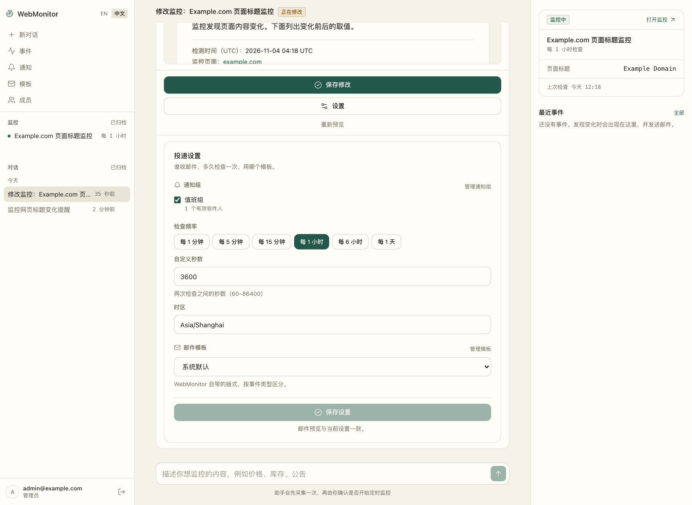

<h1 align="center">WebMonitor-Agent</h1>

<p align="center">
  <strong>A website monitor you set up by talking to it.</strong>
</p>

<p align="center">
  Describe a public page and the change you care about. Review a real collected sample, then explicitly confirm it before monitoring starts.
</p>

<p align="center">
  <a href="#what-it-is">Overview</a> ·
  <a href="#install-in-three-steps">Quick start</a> ·
  <a href="#create-your-first-monitor">First monitor</a> ·
  <a href="#email-and-webhook-alerts">Alerts</a> ·
  <a href="#faq">FAQ</a> ·
  <a href="#update-roll-back-and-your-data">Updates and data</a> ·
  <a href="./README.zh-CN.md">简体中文</a>
</p>



## What it is

WebMonitor-Agent is a self-hosted change monitor for public web pages. Instead of writing selectors or cron expressions, you describe the target and condition in a conversation. The assistant inspects the page, proposes a collection definition and runs a real preview. Only your click on **Create monitor** starts the schedule.

One Docker Compose stack runs the Next.js interface, FastAPI service and background workers, PostgreSQL, S3-compatible evidence storage and a Squid egress proxy. Apart from your model endpoint and optional notification destinations, the stack is self-contained.

Rules can watch text, keywords appearing or disappearing, numeric thresholds, percentage or absolute changes, and new, updated or removed list items. Checks can run every 1 minute to 24 hours.

### Collection boundaries

- Targets must be public `http://` or `https://` pages on ports 80 or 443. Intranet and localhost addresses, other ports and pages behind a sign-in are not supported.
- The collector reads HTML first and uses a sandboxed browser when JavaScript is required. It cannot read iframe or Shadow DOM content, and automation-blocking pages may fail. Preview coverage warnings identify partial reads.
- Collection reaches targets only through the bundled egress proxy. If the browser sandbox is unavailable, the check fails as `browser_unavailable`; it never falls back to an unsandboxed browser.

## How it works

1. **Describe the target.** Provide the URL, the values that matter, how often to check and when to notify.
2. **Review a real preview.** The assistant collects the page and shows extracted values, coverage, saved evidence and the actual email or webhook payload. Ask for changes to take another sample.
3. **Confirm explicitly.** **Create monitor** is the only action that starts scheduled checks. Previews expire after 60 minutes, and a replacement preview must be reviewed and confirmed again.
4. **Inspect results.** Successful checks retain their values, coverage and page archive, and events link to the checks that produced them.

Previews never send notifications. The first successful check records a baseline without notifying; comparisons begin with the second check. Evidence is committed only after its upload succeeds, so a failed check keeps the last successful baseline.

## Before you start

- Docker Engine with Docker Compose v2 on Linux, macOS or Windows.
- An OpenAI-compatible Chat Completions endpoint, API key and model name for conversational setup.
- An SMTP account for optional email alerts; HTTPS webhooks do not require SMTP.
- A page URL that opens without signing in.

## Install in three steps

### 1. Download the deployment files

```sh
mkdir -p webmonitor-agent/deploy/proxy webmonitor-agent/deploy/egress
cd webmonitor-agent

set -eu
BASE=https://raw.githubusercontent.com/webmonitor/WebMonitor-Agent/main

for path in \
  compose.yaml \
  .dockerignore \
  deploy/proxy/nginx.conf \
  deploy/browser-seccomp.json \
  deploy/minio.Dockerfile \
  deploy/egress.Dockerfile \
  deploy/egress/squid.conf \
  deploy/egress/entrypoint.sh \
  deploy/minio-artifacts.json
do
  if ! curl --fail --silent --show-error --location "$BASE/$path" --output "$path"; then
    printf 'download failed: %s\n' "$path" >&2
    exit 1
  fi
done
```

The loop stops and names the file if a download fails; run it again before starting. Keep every file: Compose mounts the nginx, seccomp and egress configuration and builds two local helper images from the Dockerfiles.

```text
webmonitor-agent/
├── .dockerignore
├── .env
├── compose.yaml
└── deploy/
    ├── browser-seccomp.json
    ├── egress.Dockerfile
    ├── minio.Dockerfile
    ├── minio-artifacts.json
    ├── egress/
    │   ├── entrypoint.sh
    │   └── squid.conf
    └── proxy/
        └── nginx.conf
```

### 2. Create `.env`

Create `.env` next to `compose.yaml`:

```dotenv
# :latest follows stable releases. Pin a version such as 1.1.0 for repeatable installs.
WEBMONITOR_IMAGE=ghcr.io/webmonitor/webmonitor-agent:latest
WEBMONITOR_HTTP_PORT=8080

# The address you open in the browser. Keep the same port as above.
APP_ORIGIN=http://localhost:8080
DEVELOPMENT_MODE=true

# Generate a separate database password and session signing key.
POSTGRES_PASSWORD=replace-with-a-strong-database-password
SECRET_KEY=replace-with-at-least-32-random-characters

# The first account, created on first start when no user exists yet.
ADMIN_EMAIL=admin@example.com
ADMIN_PASSWORD=replace-with-a-12-to-128-character-password

# Model service for the assistant. Any OpenAI Chat Completions endpoint works.
OPENAI_API_KEY=replace-with-your-model-api-key
OPENAI_BASE_URL=https://api.openai.com/v1
OPENAI_MODEL=replace-with-your-model-name
# Public model calls use EGRESS_PROXY_URL. For an explicit in-stack model
# service, set its internal URL instead; only that endpoint bypasses the proxy.
# OPENAI_CONTAINER_BASE_URL=http://model:8000/v1

# What a monitor created in the chat starts with (optional). Recipients, cadence,
# channel and the mail template are edited on the monitor itself, under
# "Delivery settings".
# DEFAULT_INTERVAL_SECONDS=3600
# DEFAULT_NOTIFICATION_GROUP=
# DEFAULT_DELIVERY_CHANNEL=email
# DEFAULT_WEBHOOK_URL=

# Email alerts (optional). Rules are under "Email and webhook alerts" below.
# SMTP_HOST=
# SMTP_PORT=465
# SMTP_USERNAME=
# SMTP_PASSWORD=
# SMTP_USE_SSL=true
# SMTP_STARTTLS=false
# MAIL_FROM=
```

Replace every `replace-with-...` value. Generate `SECRET_KEY` and the database password separately with `openssl rand -hex 32`. Use a 12–128 character administrator password. If `ADMIN_PASSWORD` is empty, no account is created at startup; use the [FAQ](#faq) command to create one later.

Keep `DEVELOPMENT_MODE=true` for local `http://` access. If you change `WEBMONITOR_HTTP_PORT`, update the host and port in `APP_ORIGIN` too. See [`.env.example`](https://github.com/webmonitor/WebMonitor-Agent/blob/main/.env.example) for all settings.

### 3. Start the stack

```sh
docker compose up -d --wait
```

This pulls the application image, builds the helper images on the first run and waits for health checks. Open **[http://localhost:8080](http://localhost:8080/)** after `docker compose ps` shows no service restarting or exited.

For startup failures, inspect `docker compose ps` and `docker compose logs` (optionally followed by a service name). The readiness check is:

```sh
curl --fail http://localhost:8080/api/v1/health/ready
```

It returns `{"status":"ready"}` when ready. By default the site binds only to `127.0.0.1` on the Docker host; use that machine's browser or an SSH tunnel.

## Create your first monitor

Sign in with the `ADMIN_EMAIL` and `ADMIN_PASSWORD` from `.env`. The **EN / 中文** switch changes the interface language.

### 1. Create a notification group

Open **Notifications** → **Notification groups** → **New**, name the group, add recipients one per line (commas or spaces also work) and save. Every monitor delivers through a group; only administrators can create groups.

Members see a group's name, enabled state and active recipient count, never its addresses. Their previews and monitor details show the protected count with an empty address list, and email delivery records hide destinations; administrators see the approved snapshot.

Recipient authorization is part of confirmation:

- Adding recipients requires a new preview and confirmation for each monitor. Removing or deactivating a member, or disabling its approved group, revokes that source for pending and future mail. An unrelated group does not restore authorization, although another group approved for the same monitor may still authorize the address.
- Editing a group preserves existing recipients' enabled states; new addresses start enabled. A group used by a non-archived monitor cannot be deleted until those monitors use another group or are archived.

### 2. Describe and preview

Click **New conversation** and describe the page and condition. The assistant asks for missing collection details, reads the page and shows its work log. Channel, destination, frequency, timezone and email template are configured separately rather than collected by the chat.

The inline confirmation card contains a real sample: monitor and schedule details, extracted values, coverage, page screenshot/archive when available, and the real email body or exact webhook JSON for each possible event. It also warns about partial coverage or fields required by the mail but missing from the page.

If the sample is wrong, ask for another. Queued, running and failed states are shown; failed, missing or expired samples can be retried. Creating or saving always confirms the exact preview shown, so a replacement preview requires fresh review.

### 3. Confirm and manage

**Create monitor** remains disabled until a valid sample exists and starts scheduled checking only when clicked. A sample is valid for 60 minutes. Creation also requires an enabled notification group.

New monitors start with `DEFAULT_INTERVAL_SECONDS` and either `DEFAULT_NOTIFICATION_GROUP` or the first enabled group. On the monitor page:

- **Delivery settings** edits recipients, channel, cadence, timezone and email template without discarding the collected baseline.
- **Edit definition** edits the collection JSON, creates a draft and runs another real preview; only confirming that preview publishes the change. **Raw definition (JSON)** and **Definition versions** expose the executed definition and its published history.
- **Check history** retains successful values, coverage, screenshots and archives with the collection spec used for that run. Events link to their checks.
- **Pause** / **Resume** controls scheduling; pausing cancels queued or running collection. **Check now**, cancellation and failed-check retry are available from the monitor and check details. **Archive** stops checks while retaining history; **Restore** returns the monitor paused.
- **Events** records detected changes. **Notifications** → **Delivery log** shows channel, destination, status, attempts, payload and errors, with retry for failed or cancelled deliveries.
- **Email templates** provides model-assisted reusable designs with real mail previews and validated style tokens rather than custom markup. Existing monitors keep the template design they were approved with when a template is later edited or disabled.

Administrators can invite members and disable accounts. Disabling an account revokes its sessions, pauses its monitors and cancels queued/running jobs and unsent deliveries; re-enabling does not resume or replay them.

## Email and webhook alerts

### Email

Add SMTP settings to `.env`, then run `docker compose up -d --wait`:

```dotenv
SMTP_HOST=smtp.example.com
SMTP_PORT=465
SMTP_USERNAME=alert@example.com
SMTP_PASSWORD=your-smtp-password
SMTP_USE_SSL=true
SMTP_STARTTLS=false
MAIL_FROM=WebMonitor <alert@example.com>
```

- Use the provider's encryption mode: exactly one of `SMTP_USE_SSL` and `SMTP_STARTTLS` must be `true`. Port 465 usually uses SSL; port 587 usually uses STARTTLS.
- Set `MAIL_FROM` to the sender and match the authenticated account when required. Supply both `SMTP_USERNAME` and `SMTP_PASSWORD` when authentication is required.
- `Sent` means the SMTP server accepted the message, not that it reached the inbox; check spam if necessary. Temporary failures are retried up to three times, while configuration errors are recorded as failed.

Collection results appear in **Events** and delivery status in **Delivery log**. Repeated collection failures send one alert per cause, followed by a recovery alert after success.

### HTTPS webhooks

Each monitor uses one channel selected in **Delivery settings**. Webhook URLs must use HTTPS on a public host and port 443. They follow the same egress policy as collection, and redirects are not followed.

To change the default for monitors created from new conversations:

```dotenv
DEFAULT_DELIVERY_CHANNEL=webhook
DEFAULT_WEBHOOK_URL=https://hooks.example.com/services/your-endpoint
```

Changing the default affects new drafts; existing monitors keep their settings. A delivery POSTs the previewed JSON payload containing `monitor`, `event`, `change`, `fields` and `evidence_url`, with these headers:

- `Content-Type: application/json`
- `X-WebMonitor-Event`: event type
- `X-WebMonitor-Monitor`: monitor ID
- `X-WebMonitor-Delivery`: delivery ID

Endpoints should return `2xx`. Responses `408`, `425`, `429` and `5xx` are retried; other responses are recorded as failed. **Delivery log** shows the endpoint, HTTP status and error code and supports retrying a failed delivery.

## FAQ

**The page does not load.**  
Check `docker compose ps` and `docker compose logs api web proxy`. If the port is occupied, update `WEBMONITOR_HTTP_PORT` and `APP_ORIGIN` together, then run `docker compose up -d --wait`.

**I cannot open it from another computer.**  
The default binds to `127.0.0.1`. For remote access, change the port binding in `compose.yaml`, set `APP_ORIGIN` to the actual address and configure an HTTPS reverse proxy for public access.

**No administrator exists, or sign-in fails.**  
Create an administrator interactively:

```sh
docker compose exec api webmonitor admin-create --email admin@example.com
```

The command asks twice for a 12–128 character password. `ADMIN_EMAIL` and `ADMIN_PASSWORD` apply only on the first start with an empty users table.

**How do I invite a colleague?**

```sh
docker compose exec api webmonitor invite-create --email member@example.com --ttl-hours 24
```

Send the printed link over a safe channel. It is single-use, bound to that email address and expires after 24 hours (`1`–`168` hours allowed). The recipient sets a display name and password.

**The sample is empty or covers only part of the page.**  
Review the preview's coverage warning and describe the target more precisely or choose another public page/value. iframe, Shadow DOM, authenticated and automation-blocking content cannot be collected. A genuinely empty page can represent a real state, such as all notices being removed; explicitly ask the assistant to treat it that way. Otherwise an empty read is a failed check, not a deletion.

**Create monitor is unavailable.**  
Wait for the sample or use **Retry**. If no recipient group is configured, an administrator must create one under **Notifications** → **Notification groups**.

**No notification arrived, or recipients changed without effect.**  
Check **Delivery log** for the destination, status and error. For email marked `Sent`, check spam. After changing group recipients, open the monitor's **Delivery settings** and save to approve the current set; this keeps the baseline. Also remember that the first successful check only establishes a baseline.

## Kubernetes (local development)

See [the Kubernetes guide](docs/kubernetes.md) for the single-node topology, one API replica, separate worker, required CNI and seccomp setup, Secret creation, public model/SMTP boundaries and real-cluster acceptance. Compose remains the standard single-host deployment.

## Update, roll back, and your data

### Update

Record the current image version, set `WEBMONITOR_IMAGE` in `.env` to the new tag (for example `ghcr.io/webmonitor/webmonitor-agent:1.1.0`), then update only the application services:

```sh
docker compose pull api web
docker compose up -d --wait --no-deps api web
```

`:latest` follows stable releases; a pinned version makes an install repeatable. Deployment files download from `main`, so retain the copies you actually started with. These commands leave the running database and evidence services in place.

### Roll back

Set `WEBMONITOR_IMAGE` to the previous tag and repeat the update commands.

> **The default PostgreSQL and S3 stores are ephemeral.** They use memory-backed temporary directories. Stopping, restarting or recreating `postgres` or `s3`, or running `docker compose down`, clears accounts, monitors, events and saved pages. `docker compose restart api` preserves the running data services. Configure persistent storage and backups for long-term use, and retain `.env` and the deployment files.

## Development

<details>
<summary>Build from source, image releases and internals</summary>

```sh
git clone https://github.com/webmonitor/WebMonitor-Agent.git
cd WebMonitor-Agent
cp .env.example .env
docker compose -f compose.yaml -f compose.build.yaml up --build -d --wait
```

Fill `.env` as above; [`.env.example`](./.env.example) lists every development setting. Keep both `-f` flags on later Compose commands. The build installs Chromium and takes several minutes. Run frontend tooling outside the `web` container, which contains only the compiled frontend server. See [DESIGN.md](./DESIGN.md) for internals.

The OpenAPI document is served only with `DEVELOPMENT_MODE=true`. The frontend's `generate:api` script uses it to regenerate `web/src/lib/api/schema.d.ts`; do not edit that file by hand.

Push a `vX.Y.Z` tag to publish a release. The workflow checks application versions, builds `linux/amd64` and `linux/arm64` images, publishes `:X.Y.Z` and `:X.Y`, and creates a GitHub Release. Stable releases also update `:latest`. Pull requests build without publishing; ordinary branch pushes do not run the image workflow. The two helper images are built locally from `deploy/`.

The default stack is for local use: it binds to `127.0.0.1`, terminates no TLS and keeps no durable state.

</details>

## License

[CC BY-NC 4.0](./LICENSE) — share and adapt for non-commercial use, with attribution, a license link and an indication of changes.

Created by 秋风飘起黄叶落.
