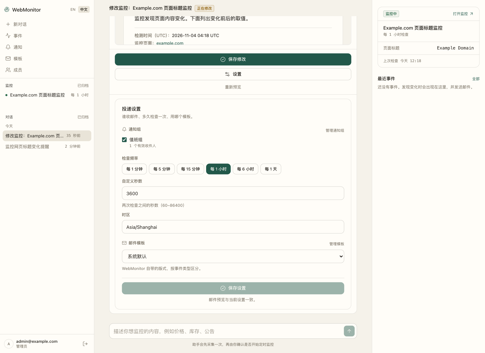

<h1 align="center">WebMonitor-Agent</h1>

<p align="center">
  <strong>用对话就能配好的网页监控。</strong>
</p>

<p align="center">
  把页面和关注条件用自己的话说清楚。助手读取页面、提取字段，并先给你看一次真实采集结果，确认之后才开始定时检查。<br>
  之后它按点运行、保存证据，符合条件时发邮件给你。
</p>

<p align="center">
  <a href="#它是什么">项目介绍</a> ·
  <a href="#三步装好">快速开始</a> ·
  <a href="#创建第一个监控">第一次使用</a> ·
  <a href="#邮件提醒">邮件提醒</a> ·
  <a href="#常见问题">常见问题</a> ·
  <a href="#更新回退与数据保留">更新与数据</a> ·
  <a href="./README.md">English</a>
</p>



## 它是什么

WebMonitor-Agent 是一个自托管的公网网页变化监控系统。你不需要写选择器，也不需要写定时表达式：对着助手把需求讲清楚就行。助手会打开目标页面、提出要提取的内容、真实采集一次，再把结果摆到你面前。只有你点下 **创建监控**，定时检查才会开始。

整套系统由一个 Docker Compose 栈运行：Next.js 界面、带后台循环的 FastAPI 服务、PostgreSQL、兼容 S3 的证据存储，以及 Squid 出网代理。除了你配置的模型服务和可选的 SMTP 邮箱，不需要任何外部账号或托管服务。

### 它能帮你盯什么

任意公开网页。你说清楚哪些值重要、什么算发生变化；系统里没有“页面类型”“商品”“价格”或“公告栏”这类内置概念。

通知条件可以看一段文本，也可以看关键词出现或消失、数值超过阈值、涨跌幅、以及列表里新增、更新或消失的条目。

默认检查公网 `http://` / `https://` 页面（80 或 443 端口），间隔为 1 分钟到 24 小时。需要登录才能看的页面、iframe 和 Shadow DOM 里的内容目前采集不到；预览卡片会写明只覆盖了页面的一部分这类限制。

## 它是怎么工作的

1. **描述目标。** 粘贴网址，说明在意什么、多久检查一次、什么情况下通知。
2. **让助手去读页面。** 它先直接抓取 HTML，遇到需要 JavaScript 才出现的数据会改用沙箱浏览器打开。它会记录找到了哪些字段，以及这次读取覆盖了页面的多少内容。
3. **核对真实采集结果。** 确认卡片里给出采集到的取值、覆盖范围、将要触发的规则、收件人、页面存档和真实邮件正文。哪里不对就在对话里说，助手会重新采集。
4. **确认后才开始定时。** **创建监控** 是唯一起作用的一下。预览有效期 60 分钟，被新的预览替换后需要重新确认。

系统保证的行为：

- 预览从不发邮件，第一次成功检查只记录比较基线。
- 证据上传成功之后才提交引用；某次检查失败时继续用上一次成功的基线比较。
- 每次检查都保存取值、覆盖范围和页面存档，每个事件都能追溯到产生它的那次检查。
- 浏览器在沙箱中运行；沙箱不可用时检查以 `browser_unavailable` 失败，不会退回无沙箱浏览器。
- 采集只通过内置的出网代理访问目标。

## 开始前需要准备

- Docker Engine 与 Docker Compose v2，Linux、macOS、Windows 都可以。
- 一个兼容 OpenAI Chat Completions 的模型服务：API 密钥、接口地址和模型名称，用于对话创建监控。
- 一个可用的 SMTP 邮箱（可选），用于发送邮件提醒。
- 一个复制到无痕窗口也能直接打开的网页地址。

## 三步装好

创建一个空目录，下载部署文件，按模板填写 `.env`，然后启动。

### 1. 下载部署文件

```sh
mkdir -p webmonitor-agent/deploy/proxy webmonitor-agent/deploy/egress
cd webmonitor-agent

set -eu
BASE=https://raw.githubusercontent.com/webmonitor/WebMonitor-Agent/main

for path in \
  compose.yaml \
  .dockerignore \
  deploy/proxy/nginx.conf \
  deploy/browser-seccomp.json \
  deploy/minio.Dockerfile \
  deploy/egress.Dockerfile \
  deploy/egress/squid.conf \
  deploy/egress/entrypoint.sh \
  deploy/minio-artifacts.json
do
  if ! curl --fail --silent --show-error --location "$BASE/$path" --output "$path"; then
    printf 'download failed: %s\n' "$path" >&2
    exit 1
  fi
done
```

任何一次下载失败，循环会停下并告诉你缺哪个文件；再跑一次，等全部就位后继续。这些文件请全部保留：`compose.yaml` 会挂载 nginx、seccomp 和 egress 配置，并用下载到的 Dockerfile 在本地构建两个小辅助镜像。

```text
webmonitor-agent/
├── .dockerignore
├── .env
├── compose.yaml
└── deploy/
    ├── browser-seccomp.json
    ├── egress.Dockerfile
    ├── minio.Dockerfile
    ├── minio-artifacts.json
    ├── egress/
    │   ├── entrypoint.sh
    │   └── squid.conf
    └── proxy/
        └── nginx.conf
```

### 2. 自建 `.env`

在 `compose.yaml` 旁边新建 `.env`，写入：

```dotenv
# :latest 跟随稳定版；需要可重复部署时改成 1.1.0 这样的固定版本。
WEBMONITOR_IMAGE=ghcr.io/webmonitor/webmonitor-agent:latest
WEBMONITOR_HTTP_PORT=8080

# 你在浏览器里打开的地址，端口要和上面一致。
APP_ORIGIN=http://localhost:8080
DEVELOPMENT_MODE=true

# 分别生成数据库密码与会话签名密钥。
POSTGRES_PASSWORD=replace-with-a-strong-database-password
SECRET_KEY=replace-with-at-least-32-random-characters

# 第一个账户。首次启动且系统里还没有用户时会自动创建。
ADMIN_EMAIL=admin@example.com
ADMIN_PASSWORD=replace-with-a-12-to-128-character-password

# 助手使用的模型服务，任何 OpenAI Chat Completions 接口都可以。
OPENAI_API_KEY=replace-with-your-model-api-key
OPENAI_BASE_URL=https://api.openai.com/v1
OPENAI_MODEL=replace-with-your-model-name

# 邮件提醒（可选），规则见下面「邮件提醒」。
# SMTP_HOST=
# SMTP_PORT=465
# SMTP_USERNAME=
# SMTP_PASSWORD=
# SMTP_USE_SSL=true
# SMTP_STARTTLS=false
# MAIL_FROM=
```

把 `replace-with-...` 替换为自己的配置。`SECRET_KEY` 和数据库密码可分别用 `openssl rand -hex 32` 生成；管理员密码长度为 12–128 个字符。

`ADMIN_PASSWORD` 留空的话，启动时不会创建账户，之后可以用[常见问题](#常见问题)里的命令补建。

本地 `http://` 地址使用 `DEVELOPMENT_MODE=true`。修改 `WEBMONITOR_HTTP_PORT` 时，同步更新 `APP_ORIGIN` 的主机和端口。完整配置项见 [`.env.example`](https://github.com/webmonitor/WebMonitor-Agent/blob/main/.env.example)。

### 3. 一条命令启动

```sh
docker compose up -d --wait
```

命令会拉取应用镜像，首次运行时联网构建两个辅助镜像，启动配套服务并等待健康检查完成。

顺利时命令正常结束，`docker compose ps` 里没有服务在反复重启或已退出。然后打开 **[http://localhost:8080](http://localhost:8080/)**。

启动失败时，用 `docker compose ps` 查看服务状态，用 `docker compose logs` 查看错误；命令后可追加服务名。健康接口 `curl --fail http://localhost:8080/api/v1/health/ready` 正常返回 `{"status":"ready"}`。

站点只绑定在运行 Docker 这台机器的 `127.0.0.1` 上。用这台机器的浏览器打开，或者从你自己的机器建一条 SSH 隧道。

## 创建第一个监控

用 `.env` 里的 `ADMIN_EMAIL` 和 `ADMIN_PASSWORD` 登录。首次启动会自动创建这个账户；如果没创建成功，见[常见问题](#常见问题)。侧栏顶部的 **EN / 中文** 可以切换界面语言。

### 先建一个通知组

**通知** → **通知组** → **新建**，填名称，收件人每行一个（用逗号或空格分隔也可以），点 **保存**。

通知组只有管理员能建，成员需要请管理员创建。监控通过通知组发信，一个组可以放多个邮箱；成员能看到组的名称、启用状态和启用人数，但看不到具体邮箱。新增收件人后，每项监控都需要重新预览和确认。移除或停用成员、停用其已批准的通知组，会撤销待发送和后续邮件的对应授权来源；无关通知组不能恢复授权。同一监控批准过的其他通知组仍可为该地址提供授权。

**删除** 需要先确认，而且仍被未归档监控引用的组会拒绝删除并说明原因：先给这些监控换一个组，或归档它们，再删除。编辑组时保持原样的收件人会保留各自的启用状态，新加的地址默认启用。

### 描述你要什么

点 **新对话**，把需求写进去，例如[它能帮你盯什么](#它能帮你盯什么)里的句子。Enter 发送，Shift+Enter 换行；跑得太久就点方块按钮停止。

接下来会看到两件事：

- 助手打开页面，并出现一条 **查看 N 步操作** 的记录，说明它做了什么：读取页面、保存采集定义。
- 助手会询问需要补充的信息，例如提取哪些内容、什么算发生变化。收件人、检查频率和邮件模板由你自己设置：在对话右侧的工作区里选。

### 核对预览再创建

在开始定时检查之前，对话里会出现一张确认卡片。点卡片上的 **设置** 就在原地展开投递设置：通知组、检查频率、时区和邮件模板。创建监控不需要另一个面板。

卡片里包含：

- 监控名称、检查频率、页面地址和时区，以及这张预览的有效期
- **采集到的内容**：它读到的字段，以及这个页面上真实的取值
- **覆盖范围**：这次检查覆盖了页面的多少内容
- **满足条件时通知**：触发邮件的规则，以及每条规则当前是否满足；变化类规则会从下一次检查开始比较
- **收件人**：会收到邮件的地址
- 采集时留下的 **页面截图** / **页面存档**
- **预览通知邮件**：这项监控可能产生的每种事件都有真实邮件正文，按所选模板渲染
- 提醒，例如 **检查范围覆盖页面的一部分**，或者邮件需要的字段这个页面并没有

哪里不对就在对话里说，助手会重新采集一张新的卡片。**重新预览** 用同样的设置再采一次；还没有采集结果时点 **试采集一次**。

预览卡片会显示排队中、运行中或失败状态；失败原因会保留，可再次重试。创建或保存监控确认的是当前显示的这一份预览；如果它被另一份预览替换，需要刷新并重新确认。

**创建监控** 这一下才是开始定时检查的动作。它需要至少一个通知组和一个检查频率；两者保存之前按钮保持禁用，卡片会说明还差什么。卡片显示 **预览已过期** 时，先重新预览——一张预览的有效期是 60 分钟。

### 创建之后

- 左侧 **监控** 里出现这项监控，并显示它的检查间隔。点进去可以看到 **上次检查**、**下次检查**、**检查频率**、**采集方式**，以及 **监控定义**：实际使用的选择器、字段、归一化、变化规则和覆盖范围。通知组、检查频率、时区和邮件模板属于单独的投递设置，在对话工作区或 **修改设置** 里编辑；每项监控也会显示所用模板名称和已批准收件人。**原始定义（JSON）** 显示采集定义本身，也就是 worker 执行的那份配置；**定义版本** 列出每次真正改变它的发布。
- **编辑定义** 直接修改这份采集 JSON：保存只会写入草稿，真实预览成功后才能保存修改；基于旧版本编辑会从该版本新建草稿。只改投递设置会保留已建立的基线，改动采集定义则重新建立基线。**修改设置** 会打开一个带有该监控当前定义和设置的对话。
- **重命名** 修改名称。**归档** 停止检查并把监控移到 **已归档**，配置和历史都会保留；**恢复** 会把它带回，并保持暂停。
- **采集历史** 保存每次成功采集。点开任意一条可以看到保存的取值、覆盖范围、截图和页面存档；事件可以跳到对应的采集记录和检查详情。
- **暂停** / **恢复** 停下或继续计划；暂停会取消排队中或正在运行的采集，监控处于运行状态时才能 **立即检查**。进行中的检查可以在检查详情里取消，失败的检查可以在那里重试。
- 左侧 **邮件模板** 存放可复用的邮件版式。用一句话说明你想要的邮件——配色、字体、疏密、要展示什么、记录链接放在哪里——模型就会连样式带结构一起写出来：带 `{monitor_name}`、`{event_label}`、`{event_date}` 变量的标题，一套样式（五种颜色、字体、标题字号、疏密、圆角、是否有边框、标签大小写），按事件类型可选的说明句，以及有序的区块（变化摘要、全部采集字段、检测时间、链接、分隔线）。样式只是一组受校验的取值，由服务端转换成 CSS，模板本身不携带任何标记。保存前会按真实邮件渲染给你看；版式不会指定任何具体字段，因此对任何监控都适用。任何成员都能新建，只有创建者或管理员能修改、停用。监控会保留批准时的那份版式，之后修改或停用模板都不会改写已有监控。
- **事件** 汇总所有发现，可以切换 **全部** / **未读**，按监控和事件类型筛选，也可以 **标为已读**。筛选条件写在地址里，刷新或分享链接会打开同一份列表；某次事件没有生成邮件时，条目会说明原因。
- **通知** → **投递记录** 列出每一封邮件：所属监控、收件人、状态、尝试次数、正文，失败时还有原因。可以按状态筛选；状态为失败或已取消的邮件可以点 **重试** 重新排队，重试次数重新计算。
- **成员**（管理员）可以启用或停用账户，并生成可复制的单次邀请链接。
- 对话、监控、检查记录、事件、通知组和投递列表均可通过 **加载更多** 访问较早记录。监控详情只显示该监控的事件。

第一次成功检查只记录起始内容，不发邮件；从第二次检查开始比较变化。预览从不发邮件。某次检查失败时，监控继续用上一次成功的内容作比较基线。

## 邮件提醒

把下面几行加进 `.env`，然后重新应用：

```dotenv
SMTP_HOST=smtp.example.com
SMTP_PORT=465
SMTP_USERNAME=alert@example.com
SMTP_PASSWORD=你的 SMTP 密码
SMTP_USE_SSL=true
SMTP_STARTTLS=false
MAIL_FROM=WebMonitor <alert@example.com>
```

```sh
docker compose up -d --wait
```

几条关键规则：

- 按邮件服务商要求选择加密方式：`SMTP_USE_SSL` 与 `SMTP_STARTTLS` 中一个设为 `true`，另一个设为 `false`。465 通常使用 SSL，587 通常使用 STARTTLS。
- `MAIL_FROM` 填写发件地址，按服务商要求与登录账户保持一致。
- 需要身份认证时，同时填写 `SMTP_USERNAME` 和 `SMTP_PASSWORD`。

SMTP 在 `.env` 中配置。采集结果记录在事件页，邮件发送状态显示在 **投递记录** 中。

`已发送` 表示邮件服务器已接受邮件。未收到时可检查垃圾邮件。临时发送失败最多重试三次，配置错误显示为失败。

## 常见问题

**页面打不开。**
用 `docker compose ps` 检查服务状态，`docker compose logs api web proxy` 查看启动错误。端口被占用时，同步修改 `WEBMONITOR_HTTP_PORT` 和 `APP_ORIGIN`，再执行 `docker compose up -d --wait`。

**在另一台电脑上打不开。**
默认访问地址绑定 Docker 主机的 `127.0.0.1`。远程访问时，修改 `compose.yaml` 的端口绑定，并将 `APP_ORIGIN` 设为实际访问地址；对外服务时配置 HTTPS 反向代理。

**登录提示邮箱或密码不正确，或者根本没有管理员。**
现在补建一个：

```sh
docker compose exec api webmonitor admin-create --email admin@example.com
```

命令会两次提示输入 12–128 个字符的密码。`.env` 里的 `ADMIN_EMAIL` 和 `ADMIN_PASSWORD` 只在首次启动、用户表为空时生效。

**怎么给同事开账号？**

```sh
docker compose exec api webmonitor invite-create --email member@example.com --ttl-hours 24
```

把打印出来的链接用可靠渠道发给对方。链接只能使用一次，绑定这个邮箱，24 小时后过期（可设 1–168 小时），并且系统中必须已有管理员。对方打开后设置显示名称和 12–128 个字符的密码。

**对话里说目标地址不在允许范围内。**
只接受公网 `http://` 或 `https://` 页面，端口限 80 或 443。内网和 localhost 地址、其他端口、需要登录的页面都不能监控。

**采集到的内容是空的，或者只有页面的一部分。**
助手先读 HTML，遇到需要 JavaScript 才出现的数据会改用浏览器打开页面。它仍然读不到 iframe 与 Shadow DOM 里的内容、登录之后的内容，以及拦截自动化的页面。预览卡片上的提醒会说明只读到了一部分；如果卡片里的值本身就是空的，监控就没有可比较的内容——把要关注的位置描述得更具体，或者换一个页面、换一个字段。页面确实为空也可以是真实状态，例如所有通知都被删除：让助手按空状态处理即可。否则空结果会被当作一次失败的采集，而不是删除。

**创建监控按钮是灰的。**
还没有可用的预览：点 **试采集一次**；过期了就点 **重新预览**。如果 **收件人** 显示「还没有收件人」，先到通知组里加收件人。

**邮件没收到。**
打开 **通知** → **投递记录** 查看收件人、发送状态和错误信息。状态为 `已发送` 时检查垃圾邮件，状态为 `失败` 时按 SMTP 错误检查配置。首次检查建立比较基准；后续变化按规则通知。连续采集失败时，同一原因发送一次失败通知，恢复后发送恢复通知。

**改了收件人却没生效。**
收件人来自通知组。改完组之后，用 **修改设置** → **保存修改** 再确认一次监控；之后第一次成功检查会重建基线。

**检查频率能设多快？**
1 分钟到 24 小时。间隔越短，对目标站点的请求越多，这台机器的负载也越高。

**需要登录才能看的页面能监控吗？**
目前支持无需登录即可访问的公开页面。

## 更新、回退与数据保留

### 更新

把 `.env` 里的 `WEBMONITOR_IMAGE` 改成新版本标签，例如 `ghcr.io/webmonitor/webmonitor-agent:1.1.0`，然后应用：

```sh
docker compose pull api web
docker compose up -d --wait --no-deps api web
```

`:latest` 跟随稳定版；固定版本号才能让部署可重复。部署文件来自 `main` 分支，请保留你实际启动时用的那一份。

更新前记录当前镜像版本。上面的命令只更新应用服务，保留仍在运行的数据库和证据存储服务。

### 回退

把 `WEBMONITOR_IMAGE` 改回上一个标签，执行上面的命令。

默认数据库和证据存储使用临时内存目录。停止、重启或重建 `postgres`、`s3`，以及执行 `docker compose down`，会清空账户、监控、事件和页面证据。`docker compose restart api` 保留仍在运行的数据服务。长期使用前配置持久存储和备份，并保存 `.env` 与部署文件。

## 开发说明

<details>
<summary>从源码构建、镜像发布与内部结构</summary>

源码开发步骤：

```sh
git clone https://github.com/webmonitor/WebMonitor-Agent.git
cd WebMonitor-Agent
cp .env.example .env
docker compose -f compose.yaml -f compose.build.yaml up --build -d --wait
```

`.env` 按上面同样的方式填写；`.env.example` 列出了全部开发配置项。后续命令都要保留这两个 `-f` 参数。构建会安装 Chromium，需要几分钟。运行中的 `web` 容器只包含编译后的前端服务，前端工具请在容器外执行。

OpenAPI 文档只在 `DEVELOPMENT_MODE=true` 时提供；前端的 `generate:api` 脚本正是从运行中的 API 重新生成 `web/src/lib/api/schema.d.ts`，这个文件不手工编辑。

推送 `vX.Y.Z` 标签即发布版本。工作流会校验声明的应用版本，构建 `linux/amd64` 与 `linux/arm64` 镜像，发布 `:X.Y.Z` 与 `:X.Y`，并创建 GitHub Release；稳定版还会更新 `:latest`。拉取请求只构建不发布，普通分支推送不触发镜像工作流。两个辅助镜像在本地由 `deploy/` 构建。

这套栈面向本机使用：只绑定 `127.0.0.1`，不终止 TLS，也不保留持久状态。

</details>

## 许可证

[CC BY-NC 4.0](./LICENSE) — 允许非商业用途的分享与改编，需署名、附许可证链接并说明改动。

作者：秋风飘起黄叶落。
